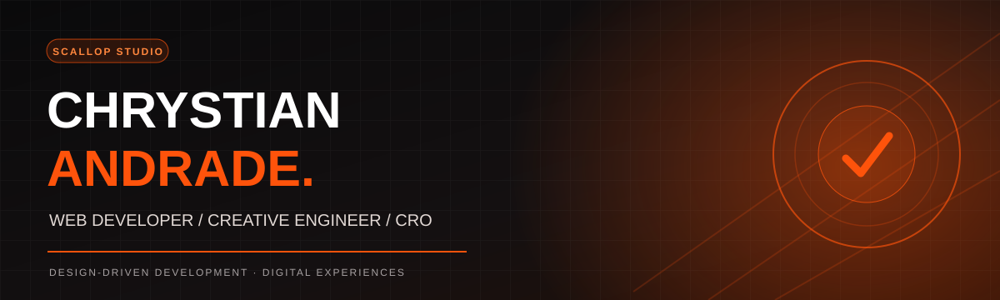

 

**DESIGN-LED DEVELOPMENT · E-COMMERCE · AUTOMATION · CONVERSION**

I design and build digital experiences that turn ideas into useful, high-performing products.

 

## 

### Creative thinking. Solid engineering. Measurable impact.

I'm **Chrystian Andrade**, a web developer and the creator of **Scallop Studio**. My work connects **UI/UX, front-end engineering, CMS and e-commerce development, CRO, analytics, and marketing automation**.

I care about every detail: from the first screen and microinteraction to mobile responsiveness, page speed, customer journeys, and reliable integrations.

`WEB DEVELOPMENT` · `UI/UX DESIGN` · `SHOPIFY` · `WORDPRESS` · `CRO` · `KLAVIYO`

---

## 

**A growing collection of websites, storefronts, customer experiences and digital systems.** Projects cover different types of involvement, including design, development, maintenance, QA, integrations and campaign automation; not every project represents an end-to-end build.

### ★ Featured digital experiences

<table>
<tr><td width="50%" valign="top">

### SCALLOP STUDIO
**Digital studio · Portfolio & web systems**

My own studio's website: services, creative direction, portfolio and digital experiences.

[**VIEW WEBSITE ↗**](https://scallop-studio.vercel.app/)

</td><td width="50%" valign="top">

### EFRAIM TURISMO
**Travel · Interactive website**

Tourism web experience focused on presenting destinations and simplifying customer enquiries.

[**VIEW WEBSITE ↗**](https://efraim-turismo.vercel.app/) · [Code](https://github.com/Anukizin/efraim-turismo)

</td></tr>
<tr><td valign="top">

### BAR G HAT SHOP
**Shopify · Klaviyo · E-commerce**

Storefront improvements, customer journeys, QR/NFC signup flows and email/SMS automation.

[**VIEW BRAND ↗**](https://barghatshop.com/)

</td><td valign="top">

### HVACSALE
**E-commerce · Shopify · Analytics**

Storefront enhancements, collection/navigation UX, shopping feeds, ads and conversion tracking.

[**VIEW BRAND ↗**](https://hvacsale.com/)

</td></tr>
<tr><td valign="top">

### DR. DARLLAN
**Premium web design · Healthcare**

Premium redesign concept with refined typography, navigation and responsive interactions.

[**EXPLORE REPOSITORY ↗**](https://github.com/Anukizin/dr-darllan-premium)

</td><td valign="top">

### PROJETO NUBAK
**Web product · Front-end**

Development project exploring web-based product interfaces.

[**EXPLORE REPOSITORY ↗**](https://github.com/Anukizin/projeto-nubak)

</td></tr>
</table>

### More websites & collaborations

| Project | Area | My work / focus |
| :-- | :-- | :-- |
| **Cabana Burger** | Food & hospitality | Digital presence and website experience |
| **Speech LP** | Landing page | Landing-page experience and conversion-focused presentation |
| **Teeki Boutique** | Fashion & e-commerce | E-commerce and digital experience |
| **Bullbee** | Brand / web | Website and digital presentation |
| **Atlanta Professional Landscaping** | Local services | Service website and lead-generation experience |
| **Sunday Club** | E-commerce lifecycle | Klaviyo delivery-flow logic, dynamic content and QA |
| **Monkefy** | Digital product | Web project · [Repository](https://github.com/Anukizin/Monkefyproject) |
| **Torque** | Brand / web | Website project |
| **KOI Build** | Brand / web | Website project |
| **Anuki** | Web / commerce | [Sales project repository](https://github.com/Anukizin/anuki-primeira-venda-facil) |
| **Fly Digital** | Digital experience | [Project repository](https://github.com/Anukizin/flyer-digital-fly) |

Some client engagements and internal builds do not have public code or an independently verified live URL. Descriptions are scoped to areas of work rather than claiming complete ownership of every site.

---

## 

**Technologies, platforms and tools in my web development ecosystem.** Platform familiarity varies from hands-on development to maintenance, integrations and project exposure.

**FRONT-END & CREATIVE DEVELOPMENT**

**BACK-END, DATA & DELIVERY**

**COMMERCE, CMS & BUILDERS**

**DESIGN, EMAIL, TRACKING & GROWTH**

Additional tools/platforms: Elementor · BigCommerce · Joomla · Craft CMS · GoHighLevel · API integrations.

---

## 

`DISCOVERY` → `UI/UX` → `DEVELOPMENT` → `QA & TESTING` → `OPTIMISATION`

- **Design with purpose:** responsive hierarchy, visual polish and accessible interactions.
- **Build for maintainability:** structured components, sensible integrations and a scalable foundation.
- **Test before delivery:** mobile/desktop checks, functional QA, tracking and customer journeys.
- **Optimise beyond launch:** ongoing improvements guided by usability, reliability and conversion goals.

---

### HAVE SOMETHING AMBITIOUS IN MIND?

**Let's build a better digital experience.**

© Scallop Studio · Design × Engineering × Growth

