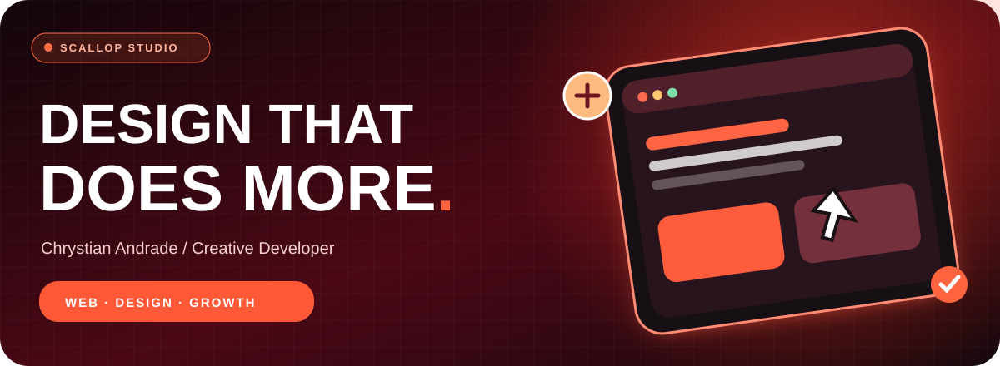
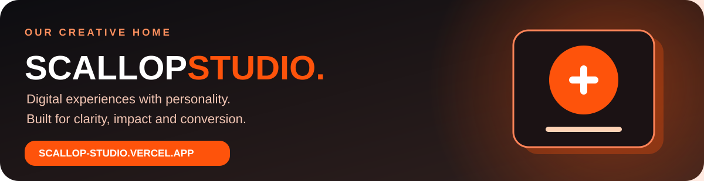
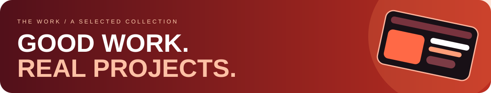

 

**CREATIVE DEVELOPMENT · DIGITAL EXPERIENCES · E-COMMERCE · AUTOMATION**

I build distinctive websites, intuitive digital products and systems that connect design to real business goals.

 

### A creative studio with an engineering mindset.

**Scallop Studio** is my digital studio, bringing together premium web development, strong UI/UX, e-commerce, conversion-focused experiences and smart marketing systems.

**[VISIT SCALLOP STUDIO ↗](https://scallop-studio.vercel.app/)**

 

### Hey, I'm Chrystian 👋

I'm **Chrystian Andrade**, a web developer and creative engineer. I love building purposeful, visually striking experiences — from immersive landing pages to Shopify storefronts, customer journeys and marketing integrations.

> **Design should make people feel something. Engineering should make everything work.**

 

 

<table>
<tr>
<td width="50%" valign="top">
<h3>🍊 Scallop Studio</h3>

<strong>Creative direction · Portfolio · Web development</strong>

My own studio and its digital home, built to showcase creative work, services and conversion-focused experiences.

<a href="https://scallop-studio.vercel.app/"><strong>Explore website ↗</strong></a>
</td>
<td width="50%" valign="top">
<h3>✈️ Efraim Turismo</h3>

<strong>Tourism · Interactive experience</strong>

Destination-led site experience with an intuitive path from inspiration to customer enquiry.

<a href="https://efraim-turismo.vercel.app/"><strong>View website ↗</strong></a> · <a href="https://github.com/Anukizin/efraim-turismo">Repository</a>
</td>
</tr>
<tr>
<td valign="top">
<h3>🤠 Bar G Hat Shop</h3>

<strong>Shopify · Klaviyo · E-commerce</strong>

Storefront improvements, custom-hat experience flows, email/SMS lifecycle work and NFC/QR capture systems.

<a href="https://barghatshop.com/"><strong>Visit brand ↗</strong></a>
</td>
<td valign="top">
<h3>⚙️ HVACsale</h3>

<strong>Shopify · Commerce · Analytics</strong>

Storefront UX, navigation, product experience, merchandising and conversion tracking.

<a href="https://hvacsale.com/"><strong>Visit brand ↗</strong></a>
</td>
</tr>
<tr>
<td valign="top">
<h3>✨ Dr. Darllan</h3>

<strong>Premium website · UI/UX</strong>

Premium healthcare website design direction, refined type, interface details and responsive interactions.

<a href="https://github.com/Anukizin/dr-darllan-premium"><strong>View repository ↗</strong></a>
</td>
<td valign="top">
<h3>💻 Projeto Nubak</h3>

<strong>Product interface · Front-end</strong>

Digital product interface exploration and web development work.

<a href="https://github.com/Anukizin/projeto-nubak"><strong>View repository ↗</strong></a>
</td>
</tr>
</table>

### More work. Different industries. One attention to detail.

<table>
<tr>
<td width="50%" valign="top">
<h3>🍔 Cabana Burger</h3>
<strong>Food & hospitality</strong> Website and digital presentation.
</td>
<td width="50%" valign="top">
<h3>🚀 Speech LP</h3>
<strong>Landing page</strong> Conversion-focused landing page experience.
</td>
</tr>
<tr>
<td valign="top">
<h3>🛍️ Teeki Boutique</h3>
<strong>Fashion & e-commerce</strong> Storefront and digital experience.
</td>
<td valign="top">
<h3>⚡ Bullbee</h3>
<strong>Brand & web</strong> Website and brand presentation.
</td>
</tr>
<tr>
<td valign="top">
<h3>🌿 Atlanta Professional Landscaping</h3>
<strong>Local services</strong> Services website and lead-generation UX.
</td>
<td valign="top">
<h3>💌 Sunday Club</h3>
<strong>Klaviyo & customer journeys</strong> Delivery emails, dynamic content and QA.
</td>
</tr>
<tr>
<td valign="top">
<h3>🏗️ KOI Build</h3>
<strong>Brand & web</strong> Website project.
</td>
<td valign="top">
<h3>✦ More client collaborations</h3>
<strong>Web, e-commerce & automation</strong> Some engagements have private deliverables or unreleased code.
</td>
</tr>
</table>

Project descriptions reflect different scopes of involvement — including design, development, maintenance, QA and automation. Some client projects do not have public repositories or confirmed live links.

 

## My creative & technical toolkit

I work across the full digital experience, from interface design to engineering, e-commerce and growth. The tools below span hands-on work and platform exposure; they don't all represent the same proficiency level.

### Front-end & interactive experiences

### Back-end, data & delivery

### CMS, stores & site builders

### Design, automation & growth

Also familiar with Elementor, BigCommerce, Joomla, Craft CMS, GoHighLevel and API integrations.

 

## The way I build

| ✦ Discover | ✦ Design | ✦ Develop | ✦ Refine |
| :-- | :-- | :-- | :-- |
| Understand the brand and the problem | Shape the interface and interaction | Build responsive, maintainable systems | Test, measure and improve |

 

### Your next project deserves more than another template.

**Let's make something bold, useful and unmistakably yours.**

© Scallop Studio · Design × Development × Growth

